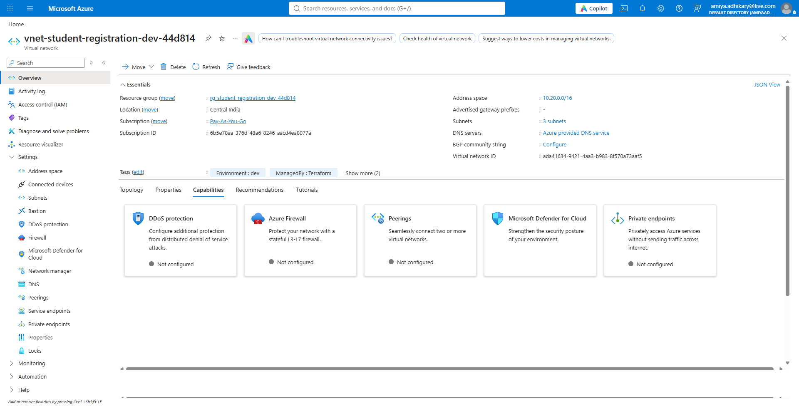
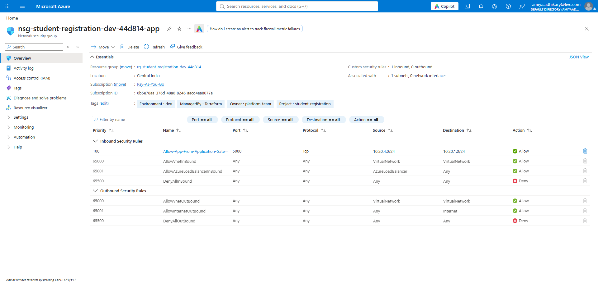
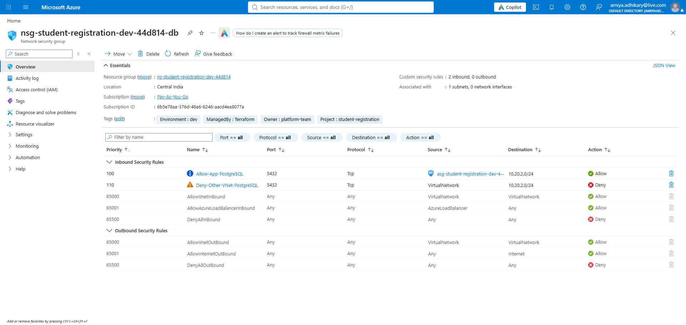
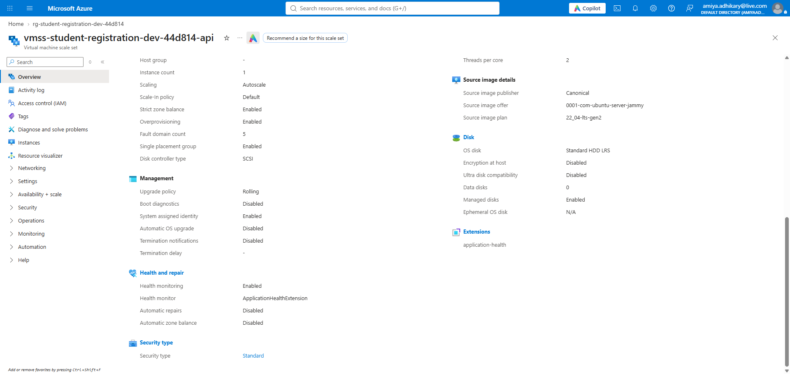
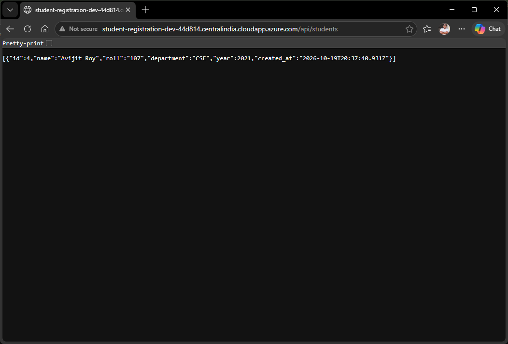
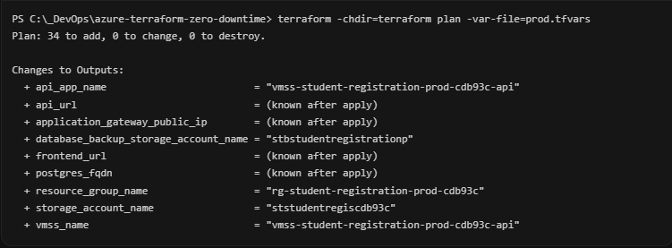

# Operation Zero Downtime — Azure Terraform

This is the Azure version of the AWS capstone for the existing React/Vite, Express/Node.js, and PostgreSQL student-registration app. It uses a public Application Gateway, private Linux VM Scale Set (VMSS), private PostgreSQL Flexible Server with Entra-only authentication, and Managed Identity-based app/release access.

## Architecture

```text
Browser --HTTP demo--> Application Gateway Standard_v2 (public)
                    | all paths --> private Linux VMSS :5000
                                  React/Vite frontend + Express API
Private VMSS subnet --NAT Gateway--> outbound package/release access
Private VMSS subnet --TCP 5432--> PostgreSQL Flexible Server (private DNS)
VMSS system-assigned Managed Identity --> PostgreSQL Entra role + private release blob
```

The VMSS and Application Gateway span the two zones selected by `availability_zones` (defaults to `1` and `2`). Azure subnets are regional rather than tied to a single zone, so the private app subnet is shared by VMSS instances in both zones. The StandardV2 NAT Gateway is zone-redundant and serves that subnet; PostgreSQL zone-redundant HA is enabled by the prod profile.

The App Gateway and API share one browser origin; the production frontend uses relative `/api` requests. The VMSS has no public IP. Its subnet NSG allows port 5000 only from the App Gateway subnet; SSH is not open. PostgreSQL has public network access disabled and accepts port 5432 only from the VMSS application security group; other VNet sources are explicitly denied. The delegated database subnet has default outbound access disabled.

The gateway uses the capstone's core HTTP listener, so no domain or certificate is needed for the demo. HTTPS and HTTP-to-HTTPS redirect are optional bonus work and are not included. The app has no user authentication; use synthetic data only and do not expose real student records. Storage holds private, Entra-authorized release artifacts only; it no longer hosts the public frontend.

The deployment script refuses public HTTP unless `ALLOW_PUBLIC_HTTP_DEMO=true` is explicitly set. This is a guard against accidentally exposing the app. Do not set it for real student data or production; obtain a domain/certificate and implement HTTPS before that use.

The minimum dev SKUs are already selected: one `Standard_B2ts_v2` VMSS instance initially (autoscaling between 1 and 2 instances), PostgreSQL `B_Standard_B1ms` with 32 GiB, no PostgreSQL HA, and no Bastion. These choices do not remove the two expensive always-on services required by this topology: Application Gateway and NAT Gateway. See [the dev cost estimate](docs/cost-estimate-dev-2026-10-19.md); the known baseline is about **$333/month while deployed**, before variable charges and tax. To keep spend low, deploy only for the capstone demo window and destroy the dev resources afterward, preserving a verified database backup first. The remote Terraform state storage remains and has a small ongoing storage charge.

## Layout

```text
terraform/
├── versions.tf, providers.tf, backend.tf
├── main.tf, variables.tf, outputs.tf
├── terraform.tfvars.example, dev.tfvars.example, prod.tfvars.example
├── .gitignore, README.md, ANSWERS.md
├── docs/architecture.md, docs/screenshots/
└── modules/
    ├── vnet/                 # VMSS, App Gateway, PostgreSQL subnets and private DNS
    ├── security_groups/      # subnet NSGs
    ├── application_gateway/  # public listener routing to the private app tier
    ├── vmss/                 # private Linux VMSS, cloud-init and app health extension
    ├── postgresql/           # private PostgreSQL Flexible Server/database
    ├── storage/              # private versioned release and backup containers
    └── bastion/              # optional VM management path; disabled by default
```

To recreate the `modules/` skeleton from scratch (Milestone 01 requirement):

```bash
for mod in vnet security_groups application_gateway vmss postgresql storage bastion; do
  mkdir -p "terraform/modules/${mod}"
  touch "terraform/modules/${mod}/"{main.tf,variables.tf,outputs.tf}
done
```

## Security Group (NSG & ASG) Rules — Least Privilege (Milestone 03)

| Security Group / Tier | Rule Name | Priority | Direction | Protocol / Port | Source | Destination | Action |
|---|---|---:|---|---|---|---|---|
| **Application Gateway** (`snet-*-appgw`) | Public HTTP Listener | — | Inbound | TCP `80` | `0.0.0.0/0` (Internet) | App Gateway Frontend IP | Allow |
| **App NSG** (`nsg-*-app`) | `Allow-App-From-Application-Gateway` | 100 | Inbound | TCP `5000` | `snet-*-appgw` CIDR (`10.20.4.0/24`) | `snet-*-app` CIDR (`10.20.1.0/24`) | Allow |
| **App NSG** (`nsg-*-app`) | `Allow-SSH-From-Bastion` *(only when `enable_bastion = true`)* | 110 | Inbound | TCP `22` | `AzureBastionSubnet` CIDR (`10.20.12.0/26`) | `snet-*-app` CIDR (`10.20.1.0/24`) | Allow |
| **DB NSG** (`nsg-*-db`) | `Allow-App-PostgreSQL` | 100 | Inbound | TCP `5432` | `asg-*-api` (Application Security Group ID) | `snet-*-database` CIDR (`10.20.2.0/24`) | Allow |
| **DB NSG** (`nsg-*-db`) | `Deny-Other-VNet-PostgreSQL` | 110 | Inbound | TCP `5432` | `VirtualNetwork` | `snet-*-database` CIDR (`10.20.2.0/24`) | Deny |
| **Outbound (App Subnet)** | NAT Gateway SNAT | — | Outbound | TCP `443` / `80` / `5432` | `snet-*-app` | Internet via `nat-*-app` & Private PostgreSQL | Allow |
| **Outbound (DB Subnet)** | Default Outbound Disabled | — | Outbound | None (`default_outbound_access_enabled = false`) | `snet-*-database` | No public internet route | Deny |

## Prerequisites

- Terraform 1.6+, Azure CLI, Bash (Linux, WSL, or Git Bash), Node.js 20+, `zip`, `curl`, `ssh-keygen`, and `sha256sum`.
- `az login`, then `az account set --subscription <subscription-id>`.
- Copy `terraform.tfvars.example` to ignored `terraform.tfvars`. Copy the desired environment example to ignored `dev.tfvars` or `prod.tfvars` and set the actual subscription ID and owner.
- The operator needs resource creation and role-assignment permissions, permission to assign the current Entra principal as PostgreSQL administrator, and Storage Blob Data Contributor on the created storage account. The deployment script discovers the Azure CLI user/service-principal name; set `TF_VAR_database_admin_principal_name` and `TF_VAR_database_admin_principal_type` if automatic discovery is unavailable. Storage role assignment may take time to propagate. The script creates the private `releases` container after the role grant is applied.
- Azure's Uniform Linux VMSS API requires a bootstrap authentication method. The guided deploy creates a one-time SSH key under its temporary directory; the private key is deleted when the script exits, and no SSH ingress rule is opened. Use the Azure control-plane Run Command helper for instance commands. This is non-interactive (unlike an SSM shell); the public bootstrap key remains in the VMSS model, so this is a documented Azure-specific deviation from the assignment's no-SSH-key requirement.

## Guided deployment

Create `terraform/dev.tfvars`, sign in to Azure, bootstrap remote state, then from the repository root run:

```bash
bash ./scripts/bootstrap-terraform-state.sh
bash ./deploy-azure.sh dev
```

The deploy script builds the React frontend and Express API into one versioned release archive, migrates/initializes the environment's remote state, validates/plans Terraform, and asks for the literal `YES` before applying. It uses the signed-in Entra identity as the PostgreSQL administrator; PostgreSQL password authentication is disabled, so no database password is passed to or stored by Terraform. After apply, it gets a short-lived Entra database token, creates the schema, maps the VMSS system identity to the least-privilege PostgreSQL app role, creates private release/backup containers, uploads the release archive, then polls the gateway health endpoint. VMSS cloud-init downloads the archive using Managed Identity. Express serves the frontend and API from the same private VMSS origin.

The VMSS uses rolling upgrades and an application health extension. Dev follows the capstone's cheaper 1-2 instance profile, so a no-interruption rolling update is not guaranteed there. Prod keeps at least two instances. Actual availability still depends on quota, zone/SKU support, database health, and a successful healthy replacement.

## Manual infrastructure commands

From the repository root, after remote state bootstrap and `az login`:

```bash
terraform -chdir=terraform init -reconfigure -backend-config=backend-dev.hcl
terraform fmt -check -recursive
terraform -chdir=terraform validate
terraform -chdir=terraform plan -refresh=false -var-file=dev.tfvars
```

The HTTP dev plan needs no domain or certificate. Do not apply directly: use `deploy-azure.sh`, which refuses to expose the public HTTP demo unless `ALLOW_PUBLIC_HTTP_DEMO=true` is explicitly set. For the first app deployment, the script creates private containers, bootstraps the database schema and app identity, uploads the release, and polls the gateway health endpoint. Use `bash ./scripts/run-vmss-command.sh dev` for a control-plane command session. Before destroying the database or environment, run `bash ./scripts/backup-postgres-before-destroy.sh dev`, verify the backup blob, then run `terraform -chdir=terraform destroy -var-file=dev.tfvars`. Azure quotas, selected-region SKU availability, RBAC propagation, DNS names, and provider/API behavior cannot be guaranteed by static validation.

## Environment profiles

| Setting | Dev example (`dev.tfvars`) | Prod example (`prod.tfvars`) |
|---|---:|---:|
| **Planned resources (`terraform plan`)** | **33 to add** *(37 if `enable_bastion = true`)* | **34 to add** *(includes `azurerm_management_lock.postgresql_delete_protection[0]`)* |
| Availability zones | 1, 2 | 1, 2 |
| API VMSS instances (initial/min/max) | 1 / 1 / 2 | 2 / 2 / 6 |
| API VM size | `Standard_B2ts_v2` | `Standard_D2s_v5` |
| PostgreSQL SKU & Storage | `B_Standard_B1ms` (32 GiB) | `GP_Standard_D2s_v3` (64 GiB) |
| PostgreSQL HA | Off (`disabled`) | `ZoneRedundant` (Primary Zone 1 + Standby Zone 2) |
| PostgreSQL delete protection | Off (`count = 0`) | `CanNotDelete` management lock (`count = 1`) |
| DB backup retention | 7 days | 14 days |
| Storage replication | `LRS` | `ZRS` (zone-redundant) |

### Summary of `terraform plan -var-file=prod.tfvars` vs `dev.tfvars` (Milestone 06)

- **`dev.tfvars` plan (`Plan: 33 to add, 0 to change, 0 to destroy`):** Provisions the resource group, VNet (`module.vnet` with 3 subnets + Private DNS zone/link = 6 resources), App & DB NSGs (`module.app_security_group` = 3 resources, `module.database_security_group` = 4 resources, plus `azurerm_application_security_group.api`), NAT Gateway + Public IP + associations (4 resources), Application Gateway `Standard_v2` + Public IP (2 resources), Linux VMSS (`Standard_B2ts_v2`, initial=1, min=1, max=2) + CPU Autoscale setting (2 resources), PostgreSQL Flexible Server (`B_Standard_B1ms`, 32 GiB, single-zone, 7-day retention) + Entra admin + database (3 resources), release + backup Storage Accounts in `LRS` + 4 RBAC role assignments (6 resources), and Application Insights (1 resource).
- **`prod.tfvars` plan (`Plan: 34 to add, 0 to change, 0 to destroy`):** Adds **`azurerm_management_lock.postgresql_delete_protection[0]`** (`CanNotDelete` lock on PostgreSQL), upgrades VMSS to **`Standard_D2s_v5`** with **`initial = 2, min = 2, max = 6`** across Zones `1` and `2`, upgrades PostgreSQL to **`GP_Standard_D2s_v3`** with **64 GiB storage**, **14-day backup retention**, and **`high_availability { mode = "ZoneRedundant", standby_availability_zone = "2" }`**, and upgrades both Storage Accounts from `LRS` to **`ZRS`**.

Blob versioning is enabled for release artifacts, HTTPS-only transfer and TLS 1.2 are enforced, and Azure Storage server-side encryption uses Microsoft-managed keys by default.
The dev VM size `Standard_B2ts_v2` has 2 vCPUs and 1 GiB RAM; PostgreSQL `B_Standard_B1ms` has 1 vCore and 2 GiB RAM. Treat these as budget dev/test sizes: monitor memory and PostgreSQL burst credits, and increase the SKU if the app becomes memory-bound or the DB repeatedly exhausts CPU credits. PostgreSQL documents Burstable as mainly for nonproduction workloads. [VM size details](https://learn.microsoft.com/en-us/azure/virtual-machines/sizes/general-purpose/bsv2-series), [PostgreSQL compute guidance](https://learn.microsoft.com/en-us/azure/postgresql/compute-storage/concepts-compute)

## Root inputs and outputs

Set the sensitive SSH public-key input and Entra admin identity through `TF_VAR_*` environment variables or an ignored local tfvars file. The database has no password input because password authentication is disabled.

| Input | Default / example | Purpose |
|---|---|---|
| `subscription_id` | Required | Azure subscription for provider deployment. |
| `owner`, `location`, `project_name`, `environment` | `platform-team`, `centralindia`, `student-registration`, `dev` | Resource metadata and deployment profile. |
| `vnet_cidr`, `availability_zones` | `10.20.0.0/16`, `1,2` | Network address space and zonal placement. |
| `enable_bastion`, `bastion_sku_name` | `false`, `Basic` | Optional controlled VM management path. |
| `database_admin_principal_name`, `database_admin_principal_type` | Required, `User` | Entra principal configured as PostgreSQL administrator. |
| `database_app_login`, `database_name`, `postgres_version` | `student_app`, `student_registration`, `16` | Application role, DB name, and engine version. |
| `postgres_sku_name`, `database_storage_mb`, `database_backup_retention_days`, `database_zone`, `database_high_availability`, `database_deletion_protection` | See dev/prod profiles | PostgreSQL sizing, resilience, retention, and delete lock. |
| `vmss_sku`, `api_instance_count`, `api_min_instances`, `api_max_instances` | See dev/prod profiles | API VM size and scale limits. |
| `vm_admin_ssh_public_key`, `vm_admin_username` | Required, `azureuser` | Linux VM administrator bootstrap key/account; private key stays outside the repo. |
| `api_release_version` | `initial` | Immutable deployment revision used to roll VMSS instances. |
| `storage_replication_type` | `LRS` | Storage durability SKU; prod example uses ZRS. |

| Output | Description |
|---|---|
| `resource_group_name` | Resource group containing the deployment. |
| `vnet_id`, `subnet_ids` | VNet and app, gateway, database, and optional Bastion subnet ID list. |
| `api_url`, `frontend_url` | Azure-generated Application Gateway HTTP demo URL. |
| `application_gateway_public_ip` | Gateway public IP address. |
| `vmss_name`, `vmss_id`, `vmss_principal_id` | API scale set identifiers and Managed Identity principal. |
| `storage_account_name`, `release_container_name` | Private versioned application release storage. |
| `database_backup_storage_account_name` | Dedicated private account for PostgreSQL exports. |
| `postgres_fqdn`, `postgres_database_name`, `database_app_login` | Private DB endpoint and app role name. |
| `database_admin_principal_name` | Configured Entra administrator. |
| `bastion_public_ip` | Bastion IP, or `null` when Bastion is disabled. |

## Cost estimate and teardown

For the dev profile in Central India, the known always-on baseline is approximately **$333.20 USD per 730-hour month**, before VM disks, Storage usage/transactions, PostgreSQL backups beyond the included allowance, NAT/data egress, Application Insights ingestion, and tax. The calculation and Azure Retail Prices API rates checked on 2026-10-19 are recorded in [the dev cost estimate](docs/cost-estimate-dev-2026-10-19.md). Actual charges depend on your agreement, usage, and current rates; verify in the [Azure Pricing Calculator](https://azure.microsoft.com/pricing/calculator/) before provisioning. The estimate assumes one B2ts_v2 VMSS instance, one PostgreSQL B1ms server, minimum one-instance App Gateway capacity, and 0 GB NAT processed data. Scale-out or traffic increases cost.

Before teardown, run `bash ./scripts/backup-postgres-before-destroy.sh dev` (or `prod`); it uses the VMSS Managed Identity and private database network to create a `pg_dump` and upload it to a separate private, versioned backup account. Verify the blob and test a restore before deleting resources. Azure Flexible Server automated backups also support PITR, but the assignment's final-snapshot behavior is represented by this explicit export workflow. The prod management lock must be removed before intentional destruction. Use the environment-specific initialized backend for destroy and retain the state account until teardown evidence and recovery needs are complete. [Azure backup/restore](https://learn.microsoft.com/en-us/azure/postgresql/backup-restore/concepts-backup-restore)

## Security, state, and scope

- VMSS uses a system-assigned Managed Identity. It receives **Storage Blob Data Reader** on the app-dedicated storage account and an Entra-linked PostgreSQL role with data permissions only. No storage key, SAS token, or database password is passed to the VM.
- PostgreSQL is configured for Microsoft Entra authentication only; password authentication is disabled. The Entra administrator identity and VMSS app-role object ID are non-secret identifiers. The short-lived SQL access token used during deployment is process-only and is not written to Terraform state or an app config file.
- Remote state uses a dedicated Azure Blob container, Entra authentication, blob versioning, and backend lease locking. Dev and prod use different keys. This configuration no longer manages a database password, but any password recorded in older state snapshots/backups remains there until those historical copies are safely rotated and purged.
- The capstone core demo uses public HTTP and has no user login/authorization or WAF policy. Do not use real student data. Add HTTPS, authentication, authorization, WAF/access policy, and appropriate monitoring before production use.
- Storage containers block anonymous public access, shared-key authorization is disabled, and release/backup blobs require Entra RBAC. Release and backup content live in separate accounts; the backup account grants the VMSS identity write access only to backup material.
- Application Insights is provisioned for the capstone, but this app has not been instrumented with the Application Insights Node SDK.
- Optional Azure Bastion is disabled by default and incurs additional cost. SSH ingress is only added from the dedicated Bastion subnet when `enable_bastion = true`.

The bootstrap script creates the state account outside the app state; `backend.tf` enables the backend and `backend-dev.hcl` / `backend-prod.hcl` are generated locally and ignored by Git. Keep separate backend keys. If migrating a workspace that already has an applied local state, run `terraform init -migrate-state -backend-config=backend-dev.hcl` once before the guided deployment; the deploy script uses `-reconfigure` so it cannot copy one environment's state into the other environment's key.

## AWS capstone mapping

| AWS requirement | Azure equivalent here | Notes |
|---|---|---|
| VPC | VNet | Separate App Gateway, private VMSS, PostgreSQL delegated, optional Bastion subnets. |
| Security Groups | NSGs | API port allowed only from the App Gateway subnet; PostgreSQL only from app subnet. |
| Public ALB | Application Gateway Standard_v2 | Public HTTP listener routes all app paths to the private VMSS; HTTPS/redirect is an optional bonus. |
| EC2 Launch Template + ASG | Linux VMSS + Azure Monitor autoscale | Rolling upgrade with health extension; VMSS has no public addresses. |
| EC2 instance profile | System-assigned Managed Identity | Reads the private release blob and authenticates to PostgreSQL without a password. |
| RDS MySQL | PostgreSQL Flexible Server | PostgreSQL retained to match the real application. |
| S3 | Azure Storage | Private, versioned release/backup blobs; React frontend is served by the private VMSS behind App Gateway. |
| NAT | NAT Gateway | Stable outbound for VM package installation/release access. |
| SSM | Azure management path/Bastion | SSH is not exposed publicly; Bastion is optional. |

## Live Azure deployment evidence (`m1` – `m6`)

- **Demo Video**: [terraform-capstone-video.mp4](docs/screenshots/terraform-capstone-video.mp4)
- **Milestone 01 (`init` & `validate`)**: 
- **Milestone 02 (VNet Plan)**: 
- **Milestone 03 (NSG & ASG Rules)**:  
- **Milestone 04 (App Gateway & VMSS Autoscale)**:   
- **Milestone 05 (Private PostgreSQL & Storage HTTPS-Only)**: 
- **Milestone 06 (`prod.tfvars` Plan & Teardown)**: 

