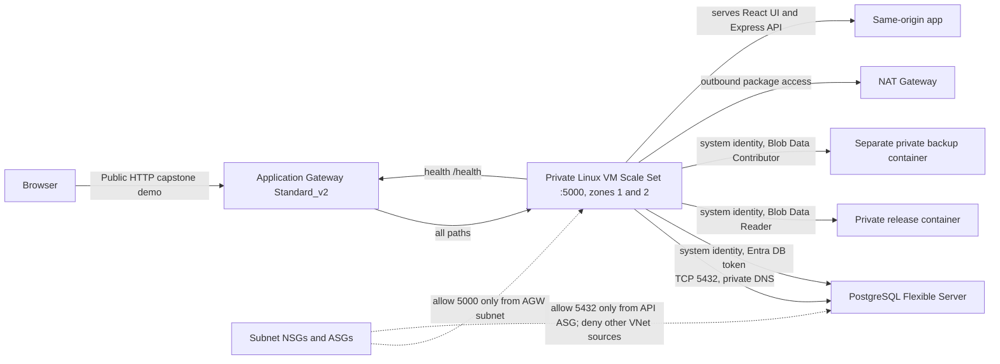

# Azure architecture

Application Gateway and VMSS are configured across the `availability_zones` variable (default `1` and `2`). Azure subnets are regional, not AZ-specific; the private app subnet is shared by instances placed in either zone. PostgreSQL uses zone-redundant high availability in the prod profile.

The gateway uses HTTP for the capstone core requirement. HTTPS and redirect are optional bonus work and require a trusted certificate/domain. Authentication has not been added; use synthetic data only. Storage holds Entra-authorized release and backup blobs in separate accounts; the public website is served by the private VMSS behind Application Gateway. PostgreSQL password authentication is disabled; the deployment operator is the Entra administrator and the VMSS identity receives a non-admin database role.
